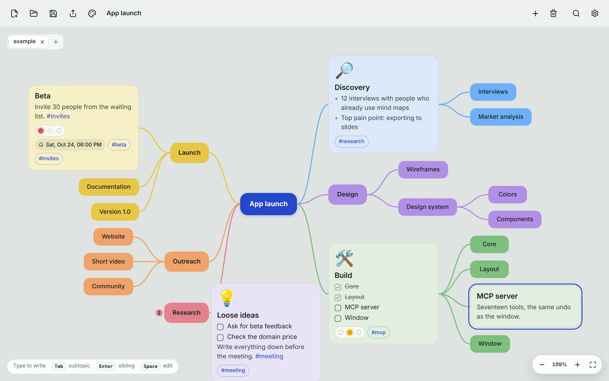
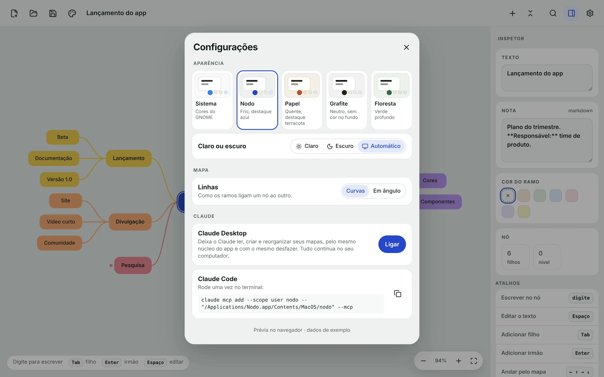
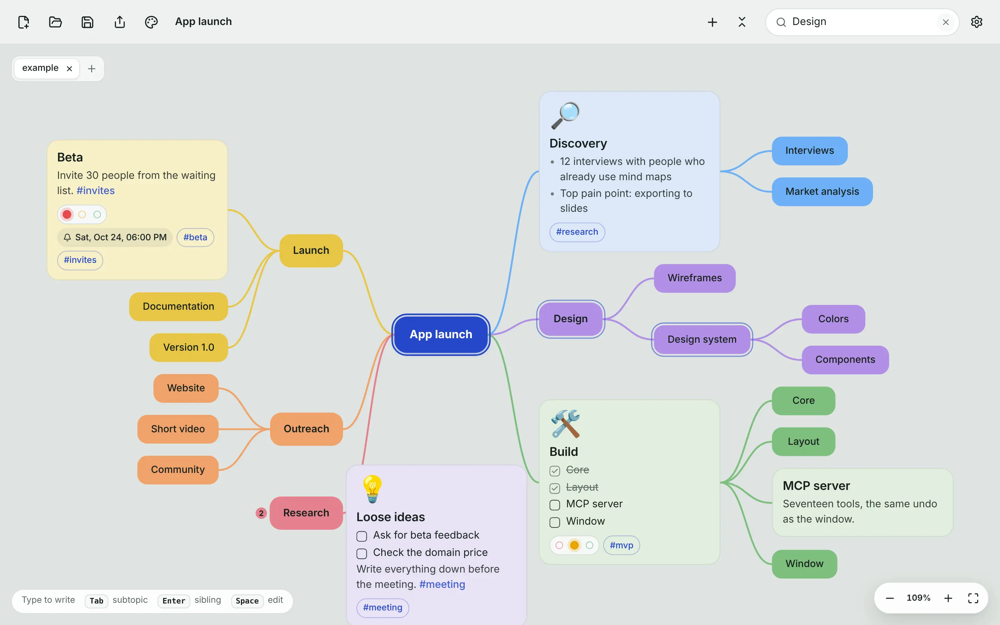
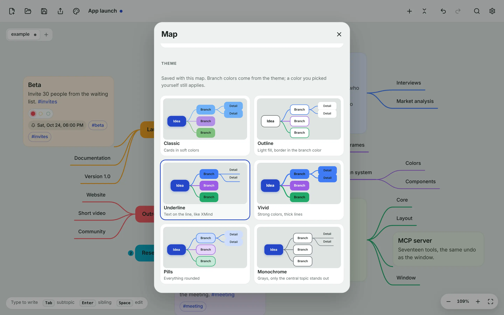
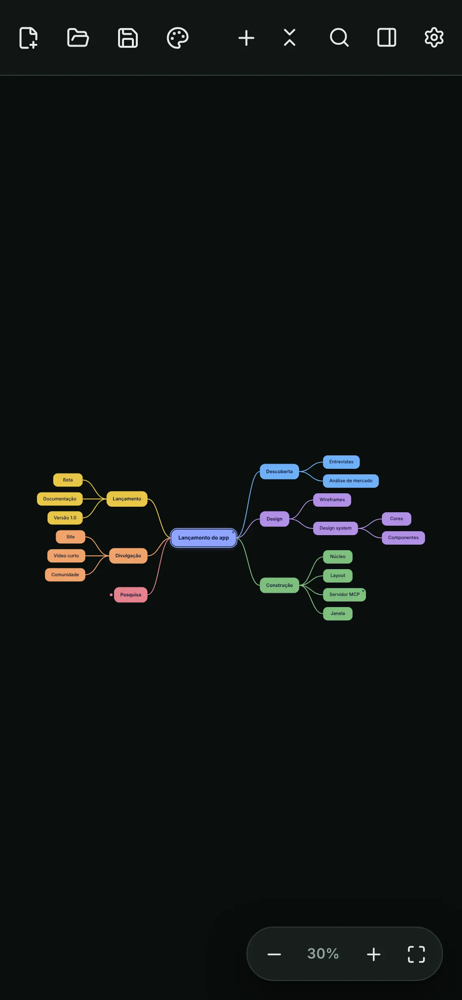

<!-- Mesmo conteúdo da página inicial do site (site/index.html). Ao mudar um, mude o outro: skill /sync-site. -->

<p align="center">
  
</p>

<h1 align="center">Nodo</h1>

<p align="center"><b>Pense em mapas.</b><br>
Um app de mapas mentais que abre num instante, funciona sem internet e guarda cada mapa num arquivo seu. Abre os mapas
do Minder sem perder nada. E o Claude pode trabalhar no mesmo mapa que você, pelas mesmas regras.</p>

<p align="center"><a href="https://github.com/wylho/nodo/releases/latest"><b>Versão 0.2: atualização automática e edição mais rápida →</b></a></p>

<p align="center">
  <b>Windows · macOS · Linux</b><br>
  <a href="#baixar"><b>Baixar</b></a> ·
  <a href="https://nodo-1c7.pages.dev">nodo-1c7.pages.dev</a> ·
  <a href="https://nodo-1c7.pages.dev/privacidade/">Privacidade</a> ·
  <a href="#english">English</a> ·
  <a href="https://github.com/sponsors/wylho">♥ Apoiar</a>
</p>

<picture>
  <source srcset="site/img/mapa-escuro.webp" media="(prefers-color-scheme: dark)">
  
</picture>

## Feito para pensar rápido

Tudo pelo teclado, nada de esperar. O mapa se arruma sozinho enquanto você escreve.

| | |
|---|---|
| **Selecione e digite** | O texto entra direto no nó. Tab cria um filho, Enter um irmão, já prontos para escrever; as setas andam pelo mapa. |
| **Dos dois lados** | Ramos à esquerda e à direita da raiz, como no Minder. Escolha o lado de cada um no painel. |
| **Notas em cada nó** | Texto curto no mapa, detalhes na nota em Markdown, que fica guardada junto. |
| **Desfazer de verdade** | Duzentos passos para trás e para a frente, sem perder o que você recolheu ou mudou de lado. |
| **Busca no mapa** | Encontra pelo texto ou pela nota, e marca cada nó que bate. |
| **Sem internet** | Nenhuma conta, nenhum servidor. O mapa é um arquivo no seu computador. |

## O Claude no mesmo mapa

O Nodo traz um servidor MCP embutido. Ligue nas Configurações e peça ao Claude para ler, criar e reorganizar seus
mapas. Ele usa o mesmo núcleo do app: cada edição dele segue as mesmas regras de uma feita à mão, e ele também desfaz
o que fez.

- Claude Desktop: um botão nas Configurações
- Claude Code: um comando para colar no terminal
- Quando o Claude salva, a janela recarrega o mapa ao voltar para ela



## Seus mapas do Minder abrem aqui

O Nodo lê e grava o formato `.minder`, o mesmo do [Minder](https://github.com/phase1geo/Minder). Um mapa vai e volta
sem perder texto, notas, cores, lados ou estilos. O arquivo continua seu, legível sem o app, e salvar nunca deixa um
arquivo pela metade.



## Temas de mapa

Seis temas, no espírito do XMind: cartões coloridos, contorno, texto sobre a linha, cores fortes, pílulas ou cinzas.
Cada ramo principal ganha uma cor e os de baixo herdam. O tema fica salvo no próprio mapa.

- Ramos em curva ou em ângulo, com cantos arredondados
- Uma cor escolhida à mão continua valendo por cima do tema



## Com a cara do seu sistema

Temas claro e escuro, e um tema Sistema que imita as cores do Windows, do macOS, do GNOME e do KDE. Funciona também numa
janela estreita.



## Baixar

Grátis e de código aberto. Os instaladores ficam na página de
[versões do GitHub](https://github.com/wylho/nodo/releases/latest). Depois de instalado, o Nodo avisa quando sai versão
nova e se atualiza sozinho.

| | |
|---|---|
| **Windows** | O `-setup.exe` (ou o `.msi`). |
| **macOS** | O `.dmg`, para Apple Silicon e Intel. Na primeira vez, clique com o botão direito no app e escolha **Abrir**: ele ainda não é assinado pela Apple. |
| **Linux** | O `.AppImage`, que roda em qualquer distribuição e se atualiza sozinho, o `.deb` ou o `.rpm`. |

**Privacidade:** sem anúncios, sem rastreamento, sem coleta de dados. Seus mapas ficam no seu computador. Leia a
[Política de Privacidade](https://nodo-1c7.pages.dev/privacidade/).

---

## English

Nodo is a free, open-source mind-mapping app for Windows, macOS and Linux. It opens instantly, works offline and keeps
each map in a file on your computer, in the format of [Minder](https://github.com/phase1geo/Minder), so your existing
Minder maps open without loss. A built-in MCP server lets Claude (Desktop and Code) read and edit the same map you are
working on, through the same core as the window.

- Select and type: Tab for a child, Enter for a sibling, both ready to write; arrows to move
- Six map themes in the spirit of XMind, saved in the map
- Branches on both sides of the root, notes in Markdown on every node, branch colours
- Curved or angled links, light and dark themes, and a System theme that follows Windows, macOS, GNOME or KDE
- 200 steps of undo; Claude can undo its own edits too
- Updates itself (Windows, macOS, AppImage): the app tells you when a new version is out

[Download the latest version](https://github.com/wylho/nodo/releases/latest).

---

## Para desenvolver

Especificação: [`docs/SPEC.md`](docs/SPEC.md). Regras do projeto: [`CLAUDE.md`](CLAUDE.md). Lançar uma versão:
[`docs/RELEASE.md`](docs/RELEASE.md).

```
crates/
├── nodo-core/   modelo, layout, .minder, Editor (histórico + arquivo), sem interface
├── nodo-mcp/    servidor MCP sobre stdio (18 ferramentas)
└── nodo-app/    janela Tauri; a interface Svelte 5 fica em ui/
site/              nodo-1c7.pages.dev (Cloudflare Pages, sem build)
```

O aplicativo e o MCP passam pelo mesmo `nodo_core::Editor`: um agente produz exatamente o mesmo resultado que uma
pessoa na janela. Um binário, dois modos: `nodo` abre a janela, `nodo --mcp` fala o protocolo.

Requer Rust 1.80+, Node 22 e pnpm. No Linux, as bibliotecas do WebKitGTK
(`libwebkit2gtk-4.1-dev libayatana-appindicator3-dev librsvg2-dev patchelf`).

```bash
pnpm --dir crates/nodo-app/ui install

# Interface no navegador, sobre um backend simulado, com recarga instantânea: o caminho para qualquer mudança visual
pnpm --dir crates/nodo-app/ui dev          # abrir http://localhost:1420/?preview

# Verificação completa
cargo fmt --all --check && cargo clippy --all-targets -- -D warnings && cargo test --workspace
pnpm --dir crates/nodo-app/ui run check && pnpm --dir crates/nodo-app/ui run test

# O app de verdade (cargo build sozinho não embute a interface e abre uma janela vazia)
crates/nodo-app/ui/node_modules/.bin/tauri build
```

### MCP fora do app

```json
{ "mcpServers": { "nodo": { "command": "/caminho/para/nodo", "args": ["--mcp"] } } }
```

Ferramentas: `new_map`, `open_map`, `save_map`, `get_map`, `get_node`, `add_node`, `remove_node`, `set_text`,
`set_note`, `set_color`, `set_side`, `set_map_theme`, `toggle_fold`, `relayout`, `search_nodes`, `undo`, `redo`,
`map_stats`.

## Licença

GPL-3.0-or-later, herdada do Minder. Veja [LICENSE](LICENSE). O Minder é de Trevor Williams e colaboradores; o Nodo
é obra derivada e leva a mesma licença.
